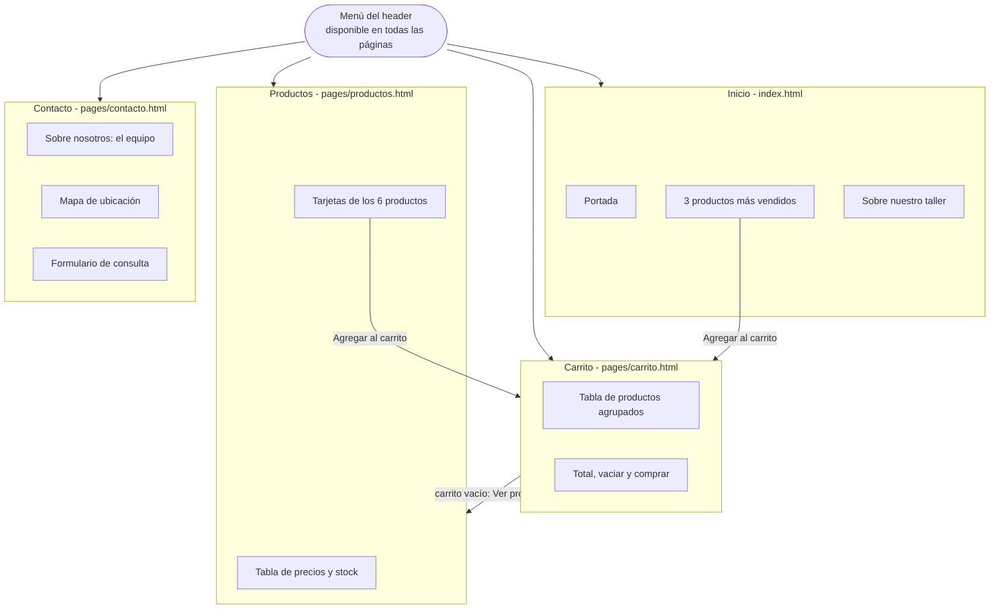
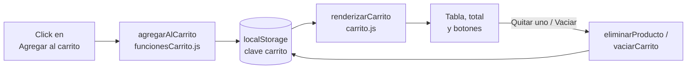

# ARTESANO - Cerámica Artesanal

Sitio web institucional y de catálogo para **ARTESANO**, un taller de cerámica hecha a mano. Es la entrega intermedia del curso de Front End: un sitio de cuatro páginas hecho con HTML, CSS y JavaScript.

El sitio permite a un visitante conocer el taller, ver los productos con su precio y su disponibilidad de stock, **armar un carrito de compras** y encontrar cómo contactarse con el equipo.

## Qué hace el sitio

### Inicio (`index.html`)
- Portada con la presentación del taller.
- Los **3 productos más vendidos**, ordenados por `cantVentas`. Las tarjetas se generan con JavaScript a partir de los datos de `js/datos.js`, con imagen, descripción, precio y un botón "Agregar al carrito".
- Sección "Sobre Nuestro Taller" con la historia y los materiales con los que trabajan (gres, porcelana y arcilla).

### Productos (`pages/productos.html`)
- **Tabla de precios y stock** de los 6 productos, con el stock marcado en verde (SI) o rojo (NO). Las filas se generan con JavaScript.
- **Tarjetas de producto** con imagen, descripción, precio y botón "Agregar al carrito", también generadas con JavaScript.
- Los productos **sin stock** (`stock: false` en `js/datos.js`, hoy Maceta y Jarra) muestran la imagen `_sin_stock` con el sello "SIN STOCK" y el botón desactivado en gris (clase `btn--disabled`); además, el código no los agrega al carrito aunque se haga click. Para cambiar la disponibilidad alcanza con editar ese dato.

### Carrito (`pages/carrito.html`)
- Cada click en "Agregar al carrito" guarda el producto en el **`localStorage`** del navegador (clave `carrito`), así que el carrito se conserva al navegar entre páginas o recargar.
- El **ícono del carrito en el header** (en todas las páginas) muestra un globito con la cantidad de productos guardados; si el carrito está vacío, el globito no aparece.
- La página del carrito muestra una **tabla con una fila por producto**: nombre, precio unitario, cantidad y subtotal. Los productos repetidos se agrupan en una sola fila.
- Última fila de la tabla con el **total** de la compra, alineado bajo la columna de subtotales.
- Botón **"Quitar uno"** en cada fila (baja la cantidad de a una unidad) y botón **"Vaciar carrito"**.
- Botón **"Comprar"** (`href="#"`): por ahora no realiza ninguna acción.
- Si el carrito está vacío, muestra un mensaje con un botón "Ver productos" que lleva al catálogo.

### Contacto (`pages/contacto.html`)
- "Sobre Nosotros": presentación del equipo del taller (Mauro, Eleonora y Juan) y una foto del taller.
- **Mapa de Google Maps** incrustado con la ubicación del taller.
- **Formulario de consulta** con nombre, email, teléfono, consulta, método de contacto preferido y producto de interés. Las consultas se envían por email mediante [Formspree](https://formspree.io), sin necesidad de backend propio.

## Diagramas

### Mapa del sitio



### Flujo del carrito



## Estructura del proyecto

```
c26236/
├── index.html            # Página de inicio
├── pages/
│   ├── productos.html    # Catálogo de productos
│   ├── carrito.html      # Carrito de compras
│   └── contacto.html     # Equipo, mapa y formulario
├── css/
│   └── styles.css        # Estilos de todo el sitio
├── js/
│   ├── datos.js          # Lista de productos (título, precio, stock, ventas, imagen)
│   ├── creaTarjetas.js   # Crea y renderiza las tarjetas de producto y su botón de agregar
│   ├── creaTabla.js      # Crea y renderiza las filas de la tabla de productos
│   ├── index.js          # Arma los 3 más vendidos del inicio
│   ├── productos.js      # Arma la tabla y todas las tarjetas del catálogo
│   ├── storage.js        # Lee, guarda y borra el carrito en localStorage
│   ├── funcionesCarrito.js # Agregar, eliminar y vaciar el carrito
│   ├── ui.js             # Contador del header y mensajes al usuario
│   ├── contador.js       # Muestra el contador del carrito al cargar cada página
│   └── carrito.js        # Agrupa los productos y dibuja la tabla del carrito
└── img/                  # Logo y fotos de productos (con y sin stock) y del taller
```

## Tecnologías

- **HTML5** semántico (`header`, `nav`, `main`, `section`, `article`, `footer`).
- **CSS3** con Flexbox y una hoja de estilos única para todo el sitio, con clases nombradas según la metodología BEM (por ejemplo `card__title`, `btn--disabled` o `btn--secundario`).
- **JavaScript** con módulos ES (`import` / `export`), manipulación del DOM para generar tarjetas, tabla y carrito automáticamente, y `localStorage` para guardar el carrito.
- **Google Fonts**: Playfair Display para los títulos y Roboto para el texto.
- **Material Symbols** (Google Fonts) para el ícono del carrito.
- **Google Maps** incrustado con un `iframe`.
- **Formspree** para recibir por email las consultas del formulario de contacto.

No usa frameworks. Como el JavaScript usa módulos ES, el sitio debe abrirse desde un servidor local (por ejemplo la extensión Live Server de VS Code); abrir `index.html` con doble click no carga los módulos.

## Limitaciones actuales

- El botón "Comprar" del carrito no realiza ninguna compra (`href="#"`); no hay pago ni confirmación de pedido.
- El carrito vive en el `localStorage` de cada navegador: no se comparte entre dispositivos ni se guarda en un servidor.
- Los productos del carrito se agrupan por título, por lo que los títulos en `js/datos.js` deben ser únicos.
- Los avisos de agregar, quitar y vaciar usan el `alert()` del navegador.
- El plan gratuito de Formspree tiene un límite mensual de consultas.

## Autor

Mauro Colombini
