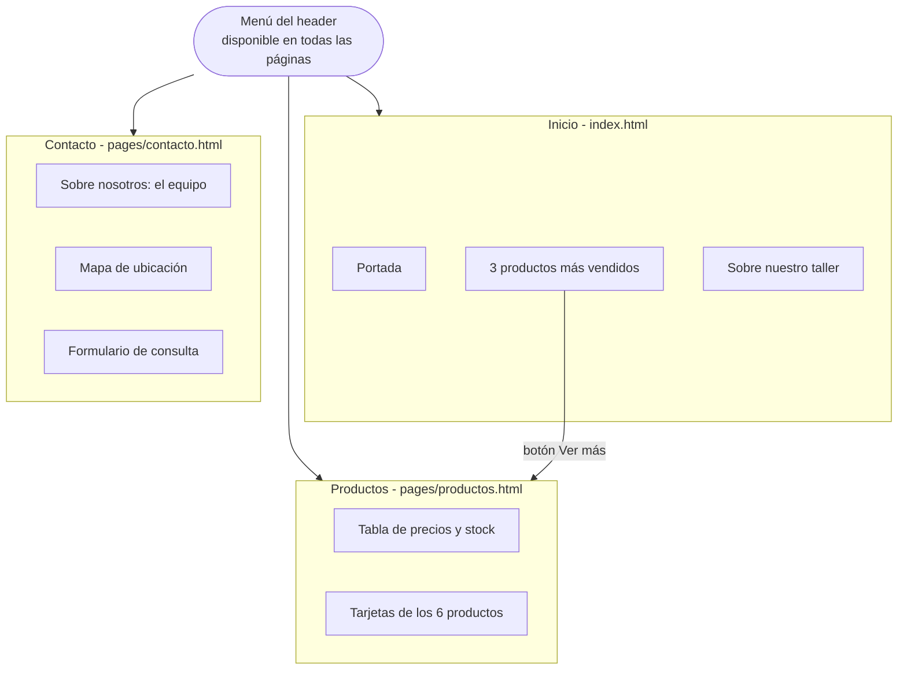

# ARTESANO - Cerámica Artesanal

Sitio web institucional y de catálogo para **ARTESANO**, un taller de cerámica hecha a mano. Es la entrega intermedia del curso de Front End: un sitio de tres páginas hecho con HTML, CSS y JavaScript.

El sitio permite a un visitante conocer el taller, ver los productos con su precio y su disponibilidad de stock, y encontrar cómo contactarse con el equipo.

## Qué hace el sitio

### Inicio (`index.html`)
- Portada con la presentación del taller.
- Los **3 productos más vendidos**, ordenados por `cantVentas`. Las tarjetas se generan con JavaScript a partir de los datos de `js/datos.js`, con imagen, descripción, precio y un botón "Comprar" que lleva al catálogo.
- Sección "Sobre Nuestro Taller" con la historia y los materiales con los que trabajan (gres, porcelana y arcilla).

### Productos (`pages/productos.html`)
- **Tabla de precios y stock** de los 6 productos, con el stock marcado en verde (SI) o rojo (NO). Las filas se generan con JavaScript.
- **Tarjetas de producto** con imagen, descripción, precio y botón "Comprar", también generadas con JavaScript.
- Los productos **sin stock** (`stock: false` en `js/datos.js`, hoy Maceta y Jarra) muestran la imagen `_sin_stock` con el sello "SIN STOCK" y el botón "Comprar" desactivado en gris (clase `btn--disabled`). Para cambiar la disponibilidad alcanza con editar ese dato.

### Contacto (`pages/contacto.html`)
- "Sobre Nosotros": presentación del equipo del taller (Mauro, Eleonora y Juan) y una foto del taller.
- **Mapa de Google Maps** incrustado con la ubicación del taller.
- **Formulario de consulta** con nombre, email, teléfono, consulta, método de contacto preferido y producto de interés. Las consultas se envían por email mediante [Formspree](https://formspree.io), sin necesidad de backend propio.

## Diagramas

### Mapa del sitio



## Estructura del proyecto

```
c26236/
├── index.html            # Página de inicio
├── pages/
│   ├── productos.html    # Catálogo de productos
│   └── contacto.html     # Equipo, mapa y formulario
├── css/
│   └── styles.css        # Estilos de todo el sitio
├── js/
│   ├── datos.js          # Lista de productos (título, precio, stock, ventas, imagen)
│   ├── creaTarjetas.js   # Crea y renderiza las tarjetas de producto
│   ├── creaTabla.js      # Crea y renderiza las filas de la tabla
│   ├── index.js          # Arma los 3 más vendidos del inicio
│   └── productos.js      # Arma la tabla y todas las tarjetas del catálogo
└── img/                  # Logo y fotos de productos (con y sin stock) y del taller
```

## Tecnologías

- **HTML5** semántico (`header`, `nav`, `main`, `section`, `article`, `footer`).
- **CSS3** con Flexbox y una hoja de estilos única para todo el sitio, con clases nombradas según la metodología BEM (por ejemplo `card__title` o `btn--disabled`).
- **JavaScript** con módulos ES (`import` / `export`) y manipulación del DOM para generar tarjetas y tabla automáticamente.
- **Google Fonts**: Playfair Display para los títulos y Roboto para el texto.
- **Google Maps** incrustado con un `iframe`.
- **Formspree** para recibir por email las consultas del formulario de contacto.

No usa frameworks. Como el JavaScript usa módulos ES, el sitio debe abrirse desde un servidor local (por ejemplo la extensión Live Server de VS Code); abrir `index.html` con doble click no carga los módulos.

## Limitaciones actuales

- El botón "Comprar" no realiza ninguna compra; el sitio es un catálogo informativo.
- El plan gratuito de Formspree tiene un límite mensual de consultas.

## Autor

Mauro Colombini
